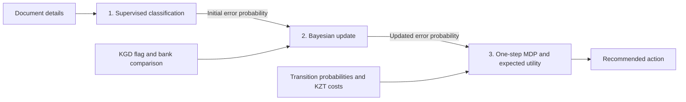

# AI Accounting Document Assistant for Kazakhstan Sole Proprietors

Sole proprietors (IPs) in Kazakhstan need to check incoming electronic invoices (ESFs), certificates of completion (AVRs), waybills, and receipts before processing them. Invalid identifiers, late linked invoices, and payment discrepancies can create accounting or tax compliance risks. This AI Fundamentals prototype estimates document error risk and recommends whether to approve the document, request a supplier correction, or send it to an accountant.

## System architecture



The classifier learns from `kz_ip_docs.csv`. The Bayesian and decision stages use `kz_rules.json`. The dataset contains 60 synthetic documents, and the evidence likelihoods, costs, and transition probabilities are course assumptions.

## Setup and demo

Run these commands from the folder containing `main.py`, `kz_ip_docs.csv`, and `kz_rules.json`.

```sh
python -m pip install scikit-learn
python main.py
```

The script compares both classifiers and runs three demos. For the notebook, open `project.ipynb` in a Jupyter kernel with scikit-learn and select **Run All**. For the browser demo, open `index.html`.

### Sample console input and output

Excerpt from the low-risk receipt demo. The full trace includes the calculation and explanation at each stage.

```text
Input: {'doc_type': 'Receipt', 'amount_kzt': 26500, 'bin_iin_valid': 1, 'esf_delay_days': 0, 'vat_payer': 1}
Output: ML prior P(Error | document features) = 2.2923%
Input: ML prior=2.2923%, external evidence={'kgd_risk_flag': 0, 'bank_statement_mismatch': 0}
Output: Updated error probability = 0.6902%
Input: P(Clean)=99.3098%, P(Erroneous)=0.6902%, configured actions and costs.
Output: Auto-Approve (648.01 KZT expected utility)
```

## Evaluation

A stratified split uses 45 documents for training and 15 for testing. Four-fold cross-validation on the training set selects the MLP by error-class F1 (0.673 versus 0.606). Both classifiers are then evaluated on the same held-out set.

| Model | Accuracy | Precision | Recall | F1 | Confusion matrix |
|---|---:|---:|---:|---:|---|
| Logistic regression | 1.000 | 1.000 | 1.000 | 1.000 | [[11, 0], [0, 4]] |
| MLP | 0.933 | 0.800 | 1.000 | 0.889 | [[10, 1], [0, 4]] |

Confusion matrix rows are actual labels and columns are predicted labels, in clean/error order. Recall matters more than accuracy for this audit scenario because a missed error can lead to an incorrect approval. Predicting every test document as clean would still give 73.3% accuracy while catching zero errors. Precision also matters because false alerts create extra review work. Both models caught all four test errors, so this small synthetic test gives limited evidence about real-world performance.

## Future development

- Add OCR to extract amounts, dates, and identifiers from scanned receipts. Flag uncertain fields for review.
- Explore authorized integration with official IS ESF and State Revenue Committee (KGD) APIs to verify invoice details and retrieve counterparty evidence.
- Validate the classifier, evidence likelihoods, and decision costs on a larger, representative set of reviewed documents.
